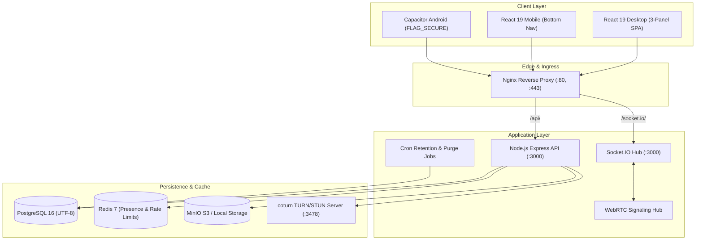

# TeamTalk — Private Enterprise Team Communication App

[](https://nodejs.org/)
[](https://react.dev/)
[](https://www.typescriptlang.org/)
[](https://www.postgresql.org/)
[](https://www.prisma.io/)
[](https://socket.io/)
[](https://webrtc.org/)
[]()

**TeamTalk** is a secure, private, WhatsApp-grade team communication platform designed for enterprises and high-trust organizations. It delivers rich messaging, voice/video calling with coturn TURN relay, 24-hour ephemeral status updates, interactive polls, audio waveform voice notes, dynamic watermark overlays, and invite-only workspace governance.

---

## Key Highlights

- **WhatsApp-Grade Realtime Features**:
  - Direct Messages, Team Groups, and Broadcast Channels.
  - Delivery and read receipts (single tick, double tick, blue double ticks).
  - Live typing indicators and user presence sync via Redis & Socket.IO.
  - Interactive multi-choice polls with live percentage bars.
  - Canvas-based audio waveform recorder and in-chat playback.
  - Emoji reactions, reply quotes, message pinning (up to 5 per chat), and message editing (15-minute window).
  - 24-Hour ephemeral Status stories with viewer counters and gradient text/media creator.

- **Audio & Video Calling (WebRTC + coturn)**:
  - 1-on-1 audio and video calls with WebRTC PeerConnection.
  - Enterprise coturn STUN/TURN server integration with ephemeral HMAC-SHA1 REST API credentials to guarantee call connectivity across NATs and corporate firewalls.
  - Local picture-in-picture (PIP) mirror preview, screen sharing, audio muting, and camera toggling.

- **Enterprise Zero-Trust Security**:
  - **Invite-Only Access**: No public self-registration. Admin-issued single-use or domain-restricted tokens.
  - **AES-256-GCM Application-Layer Encryption**: Message bodies and metadata encrypted at rest with random 96-bit IVs and authenticated additional data (AAD) bound to the `chatId` to prevent tampering.
  - **OWASP Password Security & Argon2id**: Strict entropy requirements, brute-force lockout, and SHA-256 token hashing.
  - **Multi-Factor Authentication**: RFC 6238 TOTP Authenticator apps (Google Authenticator, 1Password) with backup recovery codes.
  - **FIDO2 / WebAuthn Passkeys**: Biometric authentication support (Touch ID, Face ID, Windows Hello).
  - **Device & Session Management**: Rotating refresh tokens with token reuse detection, device identification, and one-click remote session revocation.
  - **Audit Logging**: Immutable, append-only security audit trail for login, role changes, exports, and protected chat access.

- **Anti-Exfiltration & Protected Chats**:
  - **Dynamic Watermarking**: Subtle rotated matrix watermark displaying viewer identity and timestamp across protected chats.
  - **Privacy Blur Curtain**: Content automatically blurs when the application loses focus or is backgrounded.
  - **Android `FLAG_SECURE`**: Native Capacitor Android build enforces window security flags to prevent screenshots, screen recording, and task switcher previews.
  - **Honest Security Disclosure**: Clearly communicates server-managed workspace key encryption at rest (enabling server-side search and compliance archiving) rather than making false claims of un-audited signal E2EE.

---

## System Architecture



---

## Directory Structure

```
teamtalk/
├── docker-compose.yml         # Full stack Docker Compose (Postgres, Redis, MinIO, coturn, Backend, Frontend)
├── backend/
│   ├── Dockerfile             # Multi-stage production Dockerfile
│   ├── .env.example           # Environment variables template
│   ├── prisma/
│   │   └── schema.prisma      # PostgreSQL relational schema
│   ├── src/
│   │   ├── config/env.ts      # Zod runtime environment validation
│   │   ├── lib/               # Security, crypto, storage, turn, audit, filesafety
│   │   ├── routes/            # auth, chats, messages, files, status, users, admin
│   │   ├── realtime/          # Socket.IO connection & signaling handlers
│   │   ├── jobs.ts            # Disappearing messages & retention purge worker
│   │   └── index.ts           # Express server entry point
│   └── tests/                 # Vitest test suite (39/39 passing)
├── frontend/
│   ├── Dockerfile             # Nginx SPA production Dockerfile
│   ├── package.json           # React 19, Vite, Lucide, Capacitor dependencies
│   ├── capacitor.config.ts    # Android packaging configuration
│   ├── android/               # Android native project with FLAG_SECURE
│   │   └── app/src/main/java/com/teamtalk/app/MainActivity.java
│   └── src/
│       ├── components/        # Sidebar, ChatArea, DetailsPanel, CallModal, StatusModal, AdminModal, SettingsModal, AuthScreen
│       ├── hooks/             # useProtectedCapture (blur curtain, screenshot alerts)
│       ├── services/          # api.ts, socket.ts, webrtc.ts
│       ├── styles/            # theme.css (Glassmorphic design system)
│       ├── types.ts           # Shared TypeScript interfaces
│       ├── App.tsx            # Main application controller
│       └── main.tsx           # React DOM mount
└── infra/
    ├── nginx/nginx.conf       # Nginx reverse proxy routing
    └── coturn/turnserver.conf # coturn TURN/STUN relay configuration
```

---

## Getting Started

### Option 1: Docker Compose (Recommended for Full Stack)

Run all 6 microservices with a single command:

```bash
docker compose up -d --build
```

Access services:
- **Frontend Web Application**: [http://localhost](http://localhost)
- **Backend API**: [http://localhost:3000/api](http://localhost:3000/api)
- **MinIO Storage Console**: [http://localhost:9001](http://localhost:9001) (User: `minioadmin`, Pass: `minioadmin_secret_key`)
- **coturn TURN Server**: `turn:localhost:3478`

---

### Option 2: Running Locally for Development

#### 1. Backend Setup

```bash
cd backend
cp .env.example .env

# Install dependencies
npm install

# Generate Prisma Client & push schema
npx prisma generate
npx prisma db push

# Run automated tests (All 39 unit/integration tests)
npm test

# Start development server
npm run dev
```

The backend server runs on `http://localhost:3000`.

#### 2. Frontend Setup

```bash
cd frontend

# Install dependencies
npm install

# Start Vite development server
npm run dev
```

The frontend application runs on `http://localhost:5173`.

#### 3. Building for Production

```bash
cd frontend
npm run build
```

This compiles TypeScript and outputs optimized assets into `frontend/dist/`.

---

## Native Android App Packaging (Capacitor)

The Android configuration enforces OS-level privacy protections:

1. **`FLAG_SECURE`**: Prevents screenshots, screen recording, and preview snapshots in the recent apps switcher.
2. **`setHideOverlayWindows(true)`**: Blocks malicious tapjacking and screen overlay applications.

To build the Android APK:

```bash
cd frontend

# Build web assets
npm run build

# Sync web build to native Android project
npx cap sync android

# Open in Android Studio
npx cap open android
```

In Android Studio, select **Build > Build Bundle(s) / APK(s) > Build APK(s)** to generate the release APK.

---

## Backend Test Suite Verification

The backend includes a comprehensive Vitest test suite running against an embedded UTF-8 PostgreSQL database:

```bash
cd backend
npx vitest run
```

```
✓ tests/auth.test.ts (17 tests)
✓ tests/chats.test.ts (5 tests)
✓ tests/messages.test.ts (8 tests)
✓ tests/files.test.ts (3 tests)
✓ tests/admin.test.ts (6 tests)

Test Files  5 passed (5)
     Tests  39 passed (39)
  Duration  12.4s
```

---

## Security Architecture & Honest Disclosure

- **At-Rest Encryption**: Messages, polls, and attachment metadata are encrypted with `AES-256-GCM` using workspace-managed keys. A random 12-byte initialization vector (IV) and authenticated AAD bound to the `chatId` ensure confidentiality and tamper resistance.
- **In-Transit Security**: All REST and WebSocket communication enforces TLS 1.3 in production.
- **Search & Compliance**: Decryption occurs server-side to allow high-speed search across messages, team directories, and documents.
- **WebRTC Calling**: Peer-to-peer media streams are secured using standard WebRTC DTLS-SRTP. When firewalls block direct P2P connections, traffic is routed through coturn using HMAC-SHA1 authenticated TURN relay.
- **No Deceptive Claims**: TeamTalk does not claim un-audited peer-to-peer Signal Protocol E2EE; the architecture honestly documents and implements hardened server-assisted enterprise encryption.

---

## License

Private and confidential. Built for TeamTalk Enterprise Workspace.
